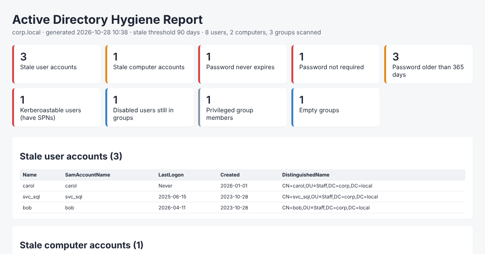

# Find Stale AD Accounts with PowerShell

**Free PowerShell script to find inactive user and computer accounts in Active Directory.** It lists enabled users and computers that haven't logged on in 90 days (or any threshold you choose) and exports them to CSV. It's read-only and safe to run in production.

[](#requirements)
[](LICENSE)
[](#is-it-safe)

🌐 **Full guide:** https://benjaminbencsik.github.io/ad-stale-accounts/

---

## Quick start

```powershell
# Download the script
Invoke-WebRequest https://raw.githubusercontent.com/benjaminbencsik/ad-stale-accounts/main/Find-StaleADAccounts.ps1 -OutFile Find-StaleADAccounts.ps1
Unblock-File .\Find-StaleADAccounts.ps1

# Find users and computers inactive for 90+ days
.\Find-StaleADAccounts.ps1

# Inactive users only, 180 days, one OU, export to CSV
.\Find-StaleADAccounts.ps1 -Days 180 -Type User -SearchBase 'OU=Staff,DC=corp,DC=local' -CsvPath .\stale-users.csv
```

Example output:

```text
Type     Name    SamAccountName LastLogon  DaysInactive Created
----     ----    -------------- ---------  ------------ -------
User     carol   carol          Never                   2026-01-01
Computer OLDPC   OLDPC$         2025-10-28          365 2022-10-28
User     bob     bob            2026-04-11          200 2023-10-28
```

## Parameters

| Parameter | Default | Description |
|---|---|---|
| `-Days` | `90` | Days without a logon before an account counts as stale |
| `-Type` | `Both` | `User`, `Computer` or `Both` |
| `-SearchBase` | whole domain | Limit to one OU (distinguished name) |
| `-Server` | nearest DC | Domain controller or domain to query |
| `-ExcludeSamAccountName` | `krbtgt`, `Guest`… | Accounts to skip; wildcards allowed (`svc_*`) |
| `-CsvPath` | none | Export results to CSV |

## How it decides an account is stale

An account is flagged when **all** of these are true:

1. It is **enabled** (disabled accounts are already out of play).
2. Its `LastLogonDate` is older than `-Days`, **or** it has **never logged on**.
3. It was **created more than `-Days` ago**, so new hires who haven't logged in yet aren't flagged.

`LastLogonDate` comes from the replicated `lastLogonTimestamp` attribute, so a single query is accurate to within about 14 days without asking every domain controller. That's plenty for a 90-day threshold.

## Requirements

- Windows PowerShell 5.1 or PowerShell 7+
- RSAT Active Directory module:
  `Add-WindowsCapability -Online -Name Rsat.ActiveDirectory.DS-LDS.Tools~~~~0.0.1.0`
- Any domain user account (reading these attributes needs no admin rights)

## Is it safe?

Yes. The script only **reads** from Active Directory and never disables, moves or deletes anything. Read the source: it's about 100 lines.

## FAQ

**How do I find users who haven't logged in for 90 days?**
Run `.\Find-StaleADAccounts.ps1 -Type User -Days 90`.

**How do I find inactive computer accounts in AD?**
Run `.\Find-StaleADAccounts.ps1 -Type Computer`. Computers change their machine password every 30 days by default, so a computer that hasn't logged on in 90+ days is almost always gone.

**Why not `Search-ADAccount -AccountInactive`?**
It works, but it doesn't skip newly created accounts, mixes in disabled ones unless you filter them, and gives you less useful output. This script handles all of that for you.

**What about cloud-only or Entra ID sign-ins?**
On-prem `lastLogonTimestamp` doesn't see sign-ins that never touch a domain controller. Check Entra ID sign-in logs before disabling hybrid users.

---

## ⭐ Need more than a list? Get the AD Hygiene Toolkit



The **AD Hygiene Toolkit** turns this into a full Active Directory cleanup and security audit:

- 📊 **Audit-ready HTML report** plus a CSV for every finding
- 🔐 **8 more checks**: password never expires, password not required, old passwords, **Kerberoastable SPN accounts**, **privileged group members** (recursive), disabled users still in groups, empty groups
- 🧹 **Safe cleanup**: disable stale accounts, stamp the description and move them to a quarantine OU, with full `-WhatIf`/`-Confirm` support
- ↩️ **One-command undo**: every change is logged and reversible
- 🏢 MSP-friendly license

👉 **[Get the AD Hygiene Toolkit](https://benjaminbencsik.github.io/ad-stale-accounts/#pro)**

---

If this script saved you time, please ⭐ **star the repo**. It helps other sysadmins find it.

**Keywords:** find stale AD accounts, inactive users Active Directory PowerShell, find inactive computers in AD, lastLogonTimestamp report, AD cleanup script, users not logged in 90 days, Active Directory audit.
